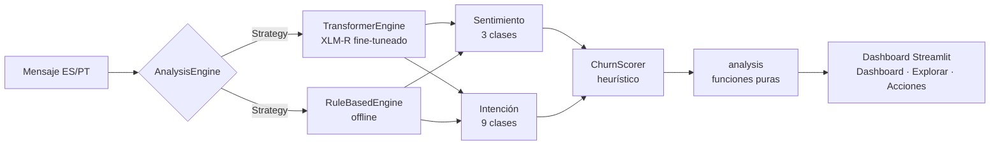

<p align="center"></p>

<h1 align="center">ConversaAI</h1>

<p align="center"><b>Bilingual (ES/PT) NLP that classifies sentiment, intent and churn risk in customer-support conversations.</b></p>

<p align="center"></p>

<p align="center">
      
</p>

<p align="center"><a href="https://dodysalim.github.io/"><b>🌐 Portfolio</b></a> · <a href="https://rosela-conversaai-dashboard.hf.space"><b>🚀 Live demo (HF Space)</b></a> · <a href="https://nocountry.tech/showcase/simulacion-laboral-abril-2026/equipo-40-data-science"><b>🏆 No Country Showcase</b></a> · <a href="README.md"><b>🇪🇸 Versión en español</b></a></p>

---

## 📌 At a glance

| | |
| --- | --- |
| **🎯 Problem** | Prioritize support conversations by understanding what each customer feels and needs. |
| **🛠️ Solution** | Two fine-tuned XLM-R models (3 sentiment classes, 9 intents) plus a heuristic churn score. |
| **📈 Published results** | ~92.2% sentiment accuracy and ~99.6% intent F1 on the team's evaluation sets. |
| **🧪 Quality** | 12 offline tests; the dashboard runs without GPU using a swappable rule-based engine. |
| **👤 My role** | Data Scientist in a 4-person team. |

## 🏗️ Architecture



## 🚀 How to run

```bash
pip install -r requirements-dashboard.txt
streamlit run dashboard-streamlit/dashboard_app.py
pip install pytest pandas && python -m pytest proyecto/tests -q
```

## ⚖️ Scope

Churn risk is a heuristic score, not a calibrated probability.

## 👥 Team

Team: Rosa Isela González Díaz · Jefferson Mangier · Dody Dueñas Remache · Geyson David. Collective authorship is preserved.

---

<p align="center">
<b>Dody Dueñas Remache</b> · Data Analyst / Data Scientist · Guayaquil, Ecuador (remote LATAM)<br>
<a href="https://dodysalim.github.io/">Portfolio</a> · <a href="https://github.com/dodysalim">GitHub</a> · <a href="https://www.linkedin.com/in/dody-duenas/">LinkedIn</a> · <a href="mailto:dodydurema67@gmail.com">dodydurema67@gmail.com</a>
</p>
