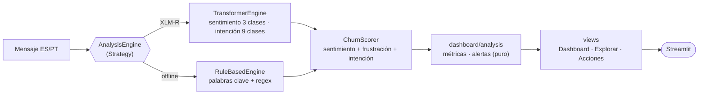

<p align="center"></p>

<h1 align="center">ConversaAI</h1>

<p align="center"><b>NLP bilingüe (ES/PT) para clasificar sentimiento, intención y riesgo de churn en conversaciones de soporte.</b></p>

<p align="center">

</p>

<p align="center">
      
</p>

<p align="center">
<a href="https://github.com/dodysalim/ConversaAI-NLP-Support-Analytics/actions"></a> 
</p>

<p align="center"><a href="https://nocountry.tech/showcase/simulacion-laboral-abril-2026/equipo-40-data-science"><b>🏆 Showcase No Country</b></a> · <a href="https://rosela-conversaai-dashboard.hf.space"><b>🚀 Demo en vivo</b></a> · <a href="https://s04-26-equipo-40-data-science.vercel.app"><b>🌐 Dashboard web</b></a> · <a href="https://dodysalim.github.io/"><b>💼 Portafolio</b></a> · <a href="README.en.md"><b>🇺🇸 English</b></a></p>

---

## 📌 Resumen en 30 segundos

| | |
| --- | --- |
| **🎯 Problema** | Priorizar conversaciones de soporte entendiendo qué siente y qué necesita cada cliente, en español y portugués. |
| **🛠️ Solución** | Dos modelos XLM-R ajustados (sentimiento de 3 clases e intención de 9 clases) y un score heurístico de churn. |
| **📈 Resultados publicados** | ~92,2 % accuracy en sentimiento y ~99,6 % F1 en intención, en los conjuntos de evaluación del equipo. |
| **🌍 Despliegue** | Modelos en Hugging Face Hub, dashboard Streamlit en HF Spaces, web en Vercel y Docker. |
| **👤 Mi rol** | Data Scientist en equipo de 4 personas. |

> 👥 **Proyecto en equipo** · Integrantes: Rosa Isela González Díaz · Jefferson Mangier · Dody Dueñas Remache · Geyson David. Copia con historial completo del [repositorio original](https://github.com/No-Country-simulation/S04-26-Equipo-40-Data-Science).

## 🔗 Enlaces

| Recurso | URL |
|---------|-----|
| Showcase oficial · Abril 2026 | [No Country Showcase](https://nocountry.tech/showcase/simulacion-laboral-abril-2026/equipo-40-data-science) |
| Repositorio GitHub | [No-Country-simulation/S04-26-Equipo-40-Data-Science](https://github.com/No-Country-simulation/S04-26-Equipo-40-Data-Science) |
| Modelo Sentimiento (HF Hub) | [Rosela/xlm-r-sentiment-espt](https://huggingface.co/Rosela/xlm-r-sentiment-espt) |
| Modelo Intención (HF Hub) | [Rosela/xlm-r-intent-espt](https://huggingface.co/Rosela/xlm-r-intent-espt) |
| Perfil HF Hub | [huggingface.co/Rosela](https://huggingface.co/Rosela) |
| Dashboard Streamlit (HF Space) | [rosela-conversaai-dashboard.hf.space](https://rosela-conversaai-dashboard.hf.space) |
| Dashboard Web (Vercel) | [s04-26-equipo-40-data-science.vercel.app](https://s04-26-equipo-40-data-science.vercel.app) |


## 👥 Equipo · Abril 2026

| Integrante | Rol publicado |
| --- | --- |
| Jefferson Mangier | Data Scientist |
| Rosa Isela González Díaz | Data Scientist |
| Dody Dueñas Remache | Data Scientist |
| Geyson David | Data analyst |

Créditos basados en el [showcase oficial](https://nocountry.tech/showcase/simulacion-laboral-abril-2026/equipo-40-data-science) y en los nombres completos documentados en este repositorio. Se conserva la autoría colectiva.

## 🏗️ Arquitectura



<details><summary>Detalle del scoring</summary>

```
Mensaje
  ├──► SentimentClassifier (XLM-R fine-tuneado)
  │     3 clases: negative / neutral / positive
  ├──► IntentClassifier (XLM-R fine-tuneado)
  │     9 clases: cancelacion, consulta_general, facturacion_pago,
  │               feedback, gestion_cuenta, modificacion_pedido,
  │               queja, reembolso, seguimiento
  └──► ChurnScorer (heurístico)
        w1 * sent_prob_negative + w2 * frust_flag + w3 * max(intent_risk)
        Pesos default: w1=0.3, w2=0.35, w3=0.35
```

### Fallback automático

Si los modelos fine-tuneados no están disponibles (sin GPU/local), el pipeline cae a:
- **Sentimiento**: `nlptown/bert-base-multilingual-uncased-sentiment` (5 estrellas → 3 clases)
- **Intención**: `MoritzLaurer/DeBERTa-v3-base-mnli` (zero-shot sobre las 9 clases)
- **Demo 100% offline**: `proyecto/scripts/pipeline_fallback.py` — rule-based por keywords + regex (sin dependencias ML)

</details>

## 🛠️ Stack

| Componente | Tecnología |
|------------|-----------|
| Modelos | XLM-R (`xlm-roberta-base`) fine-tuneado ES/PT |
| Entrenamiento | Kaggle (GPU T4x2) + Hugging Face Hub |
| Dashboard | Streamlit + Plotly |
| Infraestructura | HuggingFace Spaces + Docker (Python 3.11-slim, CPU) |
| Lenguaje | Python 3.11 |

<details>
<summary><b>🧰 Ver todas las herramientas utilizadas</b></summary>

#### Lenguaje y Entorno

| Herramienta | Uso en el proyecto |
|-------------|-------------------|
| Python 3.11 | Lenguaje principal |
| pip | Gestor de dependencias |
| venv | Entorno virtual aislado |
| Docker | Containerización para deploy |

#### Machine Learning / NLP

| Herramienta | Uso en el proyecto |
|-------------|-------------------|
| PyTorch 2.x | Backend de deep learning (CPU/GPU) |
| Hugging Face Transformers | Modelos XLM-R, tokenización, pipeline HF |
| Hugging Face Datasets | Carga y procesamiento de datasets |
| Hugging Face Hub | Registro y distribución de modelos fine-tuneados |
| scikit-learn | Split estratificado, métricas de evaluación |
| evaluate | Métricas estandarizadas (accuracy, F1) |
| accelerate | Entrenamiento distribuido en GPU |
| XLM-R (xlm-roberta-base) | Modelo base multilingual para fine-tuning |
| Tokenizers (HF) | Tokenización rápida en Rust |

#### Entrenamiento

| Herramienta | Uso en el proyecto |
|-------------|-------------------|
| Kaggle (GPU T4x2) | Entrenamiento de modelos en la nube |
| Google Colab | Alternativa para fine-tuning |
| Trainer (HF) | Loop de entrenamiento con early stopping, weight decay, label smoothing |

#### Dashboard y Visualización

| Herramienta | Uso en el proyecto |
|-------------|-------------------|
| Streamlit | Dashboard interactivo web |
| Plotly | Gráficos interactivos (pie, bar, histograma, stacked bar) |
| Matplotlib | Visualización en notebooks |
| Seaborn | Visualización estadística en notebooks |

#### Procesamiento de Datos

| Herramienta | Uso en el proyecto |
|-------------|-------------------|
| Pandas | Manipulación y análisis de datos |
| NumPy | Operaciones numéricas y arrays |
| PyArrow | Lectura/escritura de formato Parquet |
| regex (re) | Patrones de búsqueda para detección de intenciones en fallback |

#### Desarrollo y Colaboración

| Herramienta | Uso en el proyecto |
|-------------|-------------------|
| Git | Control de versiones |
| GitHub | Repositorio remoto y colaboración |
| GitHub CLI (gh) | Interacción con GitHub desde CLI |
| opencode (Spec-Driven Dev) | Flujo de trabajo: propuesta → spec → diseño → tareas → implementación → verificación |
| Engram | Memoria persistente entre sesiones de desarrollo |

#### DevOps

| Herramienta | Uso en el proyecto |
|-------------|-------------------|
| Docker | Imagen con Python 3.11-slim + dependencias + precarga de modelos |
| Docker Hub / Registry | Distribución de imágenes (futuro) |
| Healthcheck Docker | Monitoreo de salud del contenedor |

#### Productividad

| Herramienta | Uso en el proyecto |
|-------------|-------------------|
| tqdm | Barras de progreso en procesamiento por lotes |
| logging | Logging estructurado en todo el pipeline |
| threading | Lock thread-safe para singletons de fallback |

</details>

## 📊 Dashboards

### Dashboard Streamlit (HuggingFace Space)

El dashboard Streamlit está deployado en HuggingFace Spaces:
👉 [rosela-conversaai-dashboard.hf.space](https://rosela-conversaai-dashboard.hf.space)

- `app.py` — Dashboard Streamlit con clasificación de intenciones y sentimiento
- Modelos cargados desde HF Hub: `Rosela/xlm-r-intent-espt` (9 clases) + `Rosela/xlm-r-sentiment-espt`
- Labels mapeadas: las 9 clases en español (`cancelacion`, `queja`, etc.) se traducen a inglés para el dashboard
- Sube un CSV/Excel con columna `text` y analizá sentimiento, intención y riesgo de churn

### Dashboard Web (Vercel)

Dashboard web estático (HTML/CSS/JS) deployado en Vercel:
👉 [s04-26-equipo-40-data-science.vercel.app](https://s04-26-equipo-40-data-science.vercel.app)

## 💻 Dashboard local (sin GPU)

```bash
python -m pip install -r requirements-dashboard.txt
streamlit run dashboard-streamlit/dashboard_app.py
```

Por defecto usa el motor de reglas offline; desde la barra lateral se puede cambiar a los modelos XLM-R (requiere `requirements.txt`). El código está en `proyecto/dashboard/`, organizado en motores intercambiables, lógica de análisis pura, gráficos y vistas.

## 🧪 Pruebas

Las pruebas offline validan el score de churn, el pipeline de reglas y la lógica del dashboard sobre el corpus demo, sin descargar modelos:

```bash
python -m pip install pytest pandas
python -m pytest proyecto/tests -q
```

## 🐳 Docker

```bash
docker build -t conversaai .
docker run -p 8501:8501 conversaai
```

Los modelos fine-tuneados se descargan de HF Hub al arrancar (~556MB c/u).

> El dashboard Streamlit está deployado en HuggingFace Spaces.
> Para correrlo localmente: `streamlit run app.py`

## 🗂️ Dataset demo

`proyecto/data/corpus_demo_bilingue.csv` — 109 mensajes bilingües ES/PT etiquetados con sentimiento + intención para prueba.

## 📓 Notebooks Kaggle

- `proyecto/notebooks/sentiment_xlmr.ipynb.py` — Fine-tuning XLM-R para sentimiento (3 clases, ~92.2% accuracy)
- `proyecto/notebooks/intent_xlmr.ipynb.py` — Fine-tuning XLM-R para intención (9 clases, ~99.6% F1)
- `proyecto/notebooks/sentiment_xlmr_colab.ipynb` — Versión Colab del notebook de sentimiento
- `proyecto/notebooks/intent_xlmr_colab.ipynb` — Versión Colab del notebook de intención

## 🧭 Scripts

| Script | Propósito |
|--------|-----------|
| `proyecto/src/pipeline.py` | Orquestador ConversaAIPipeline |
| `proyecto/src/data/processor.py` | DataProcessor: normalización ES/PT + tokenización XLM-R |
| `proyecto/src/models/sentiment.py` | SentimentClassifier (XLM-R + fallback nlptown) |
| `proyecto/src/models/intent.py` | IntentClassifier (XLM-R + fallback zero-shot) |
| `proyecto/src/features/churn.py` | ChurnScorer heurístico |
| `proyecto/scripts/pipeline_fallback.py` | Pipeline rule-based 100% offline (demo) |
| `proyecto/scripts/archive/` | Scripts one-off legacy (preparar datos, push model, etc.) |

## 🧪 Dataset de fine-tuning (Kaggle)

Dataset en Kaggle: [rosaiselagonzalez/conversaai-sentiment-data](https://www.kaggle.com/datasets/rosaiselagonzalez/conversaai-sentiment-data)

Compuesto por:
- `amazon_reviews_multi` ES/PT (sentimiento 5 estrellas → 3 clases)
- Bitext intent dataset (27 intents originales → 9 clases limpias)
- `corpus_ecommerce.csv` (110k registros PT, sentimiento positive/negative)

---

<p align="center">
<b>Dody Dueñas Remache</b> · Analista de Datos / Data Scientist<br>
<a href="https://dodysalim.github.io/">Portafolio</a> · <a href="https://github.com/dodysalim">GitHub</a> · <a href="https://www.linkedin.com/in/dody-duenas/">LinkedIn</a> · <a href="mailto:dodydurema67@gmail.com">dodydurema67@gmail.com</a>
</p>
